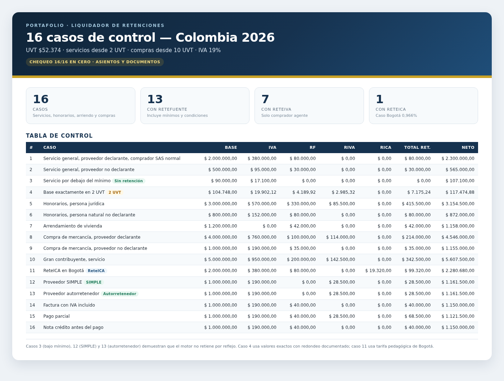
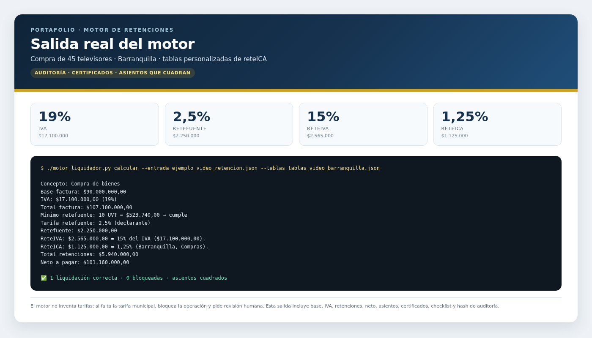
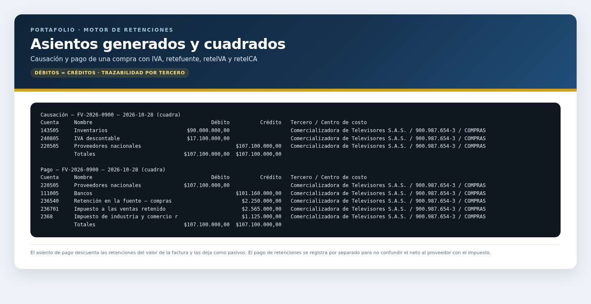

# Liquidador de retenciones Colombia 2026 — diseño y 16 casos de control

**Estado:** motor implementado y probado con los 12 casos del diseño funcional y los 16 casos de control. Listo para operar **con validación humana**; la firma de tablas oficiales y la marcha blanca son pasos de producción.
**Corte normativo:** 23/10/2026.  
**UVT 2026:** $52.374.  
**Autor:** Kelvis Samir Copete Córdoba.

> Proyecto educativo. No es asesoría tributaria ni reemplaza la revisión de un contador. Antes de usar una regla en una empresa real, verifica el RUT, el concepto, el municipio, la fecha y la norma vigente.

---

## 1. Problema

Liquidar retenciones a mano es propenso a errores:

- Se calcula retefuente sobre el total con IVA.
- Se aplica reteIVA sin ser agente de reteIVA.
- Se olvida el mínimo de 2 UVT o 10 UVT.
- Se confunde proveedor declarante con no declarante.
- Se practica retefuente a un proveedor SIMPLE o autorretenedor.
- Se registra la retención como gasto en vez de pasivo.
- No se conserva el certificado ni la trazabilidad.

Este proyecto traduce la teoría a una **tabla de decisión con memoria**: qué regla aplica, sobre qué base, con qué tarifa, con qué documento y con qué asiento.

---

## 2. Alcance

### Incluye

- Compras nacionales de bienes y servicios.
- Proveedores residentes en Colombia.
- Comprador persona jurídica con contabilidad.
- IVA general 19% y operaciones excluidas.
- Retefuente de renta.
- ReteIVA como módulo opcional, según la calidad del comprador.
- ReteICA como módulo opcional, según el municipio.
- Proveedores declarantes, no declarantes, SIMPLE y autorretenedores.
- Facturas con IVA incluido, pagos parciales y notas crédito simples.
- Asientos de causación y pago.
- Certificados y checklist documental.

### No incluye

- Nómina.
- Renta.
- Pagos al exterior y convenios de doble tributación.
- Régimen simple a fondo.
- Autorretención especial.
- Hidrocarburos, construcción, entidades públicas y salud especial.
- Servicios temporales, aseo y vigilancia con AIU.
- Prorrata de IVA.
- Moneda extranjera.
- Declaraciones automáticas ante la DIAN.
- Planeación tributaria.

**Regla de alcance:** si un caso no está en la lista “incluye”, el sistema debe bloquear el cálculo y pedir revisión humana.

---

## 3. Archivos del proyecto

| Archivo | Para qué sirve |
|---|---|
| `Control_Retenciones_16_Casos.xlsx` | Tabla de control con 16 casos, cálculo, asiento, documentos, errores y chequeo. |
| `casos.csv` | Datos de los 16 casos para revisión o importación. |
| `docs/casos-practicos.md` | 16 casos resueltos con asientos completos. |
| `docs/diseno-funcional.md` | Diseño funcional del liquidador: entradas, reglas, validaciones y pruebas. |
| `docs/tabla-retenciones-2026.md` | Tabla de referencia de conceptos, tarifas y mínimos. |
| `docs/matriz-comprador-vendedor.md` | Matriz comprador–vendedor, tipos de retención y lectura crítica de la tabla del video. |
| `liquidador.ipynb` | Implementación ejecutable del diseño funcional: motor, asientos, certificados, auditoría y 12 casos de prueba. |
| `motor_liquidador.py` | El mismo motor como script de línea de comandos: JSON de entrada, JSON/CSV de salida, repositorio de duplicados y tablas personalizables. |
| `Estudio_Motor_Liquidador.pdf` | Documento de estudio del motor (`motor_liquidador.py`): porqué de cada librería y regla tributaria, arquitectura, tutorial por línea de comandos y casos. |
| `ejemplo_video_retencion.json` + `tablas_video_barranquilla.json` | JSON del ejemplo del video (45 televisores × $2.000.000) y tablas con la reteICA de Barranquilla. |
| `Guia_JSON_Entrada_Ejercicio_Video.pdf` + `plantilla_ejercicio_video.json` | Guía para armar el JSON de entrada y plantilla para resolver el primer ejemplo del video (compra de $63.300.000). |
| `build_control.py` | Script que regenera el Excel y el CSV. |
| `README.md` | Este documento. |

---

## 4. Reglas base

| Concepto | Regla |
|---|---|
| UVT 2026 | $52.374 |
| Mínimo servicios | 2 UVT = $104.748 |
| Mínimo compras | 10 UVT = $523.740 |
| IVA general | 19% |
| Retefuente servicios | 4% declarante / 6% no declarante |
| Retefuente honorarios | 11% jurídica declarante / 10% no declarante |
| Retefuente compras | 2,5% declarante / 3,5% no declarante |
| Retefuente arrendamiento de inmueble | 3,5%; mínimo 10 UVT |
| ReteIVA | 15% del IVA, solo si el comprador es agente de reteIVA para esa operación (incluye compras a SIMPLE) |
| ReteICA | Tarifa municipal; caso 11 usa 0,966% de Bogotá como ejemplo |
| Redondeo | Definir política y mantenerla; el caso 4 muestra valores exactos y redondeo a peso |

### Banderas que cambian el cálculo

- ¿El comprador es agente de retefuente?
- ¿El comprador es agente de reteIVA?
- ¿El comprador es agente de reteICA?
- ¿El proveedor es declarante o no declarante?
- ¿El proveedor es SIMPLE?
- ¿El proveedor es autorretenedor?
- ¿La operación es servicio, honorario, arrendamiento o compra?
- ¿La base supera el mínimo?
- ¿La factura tiene IVA incluido?
- ¿Hay pago parcial o nota crédito?

---

## 5. Los 16 casos

| # | Caso | Base | IVA | Retefuente | ReteIVA | ReteICA | Neto |
|---:|---|---:|---:|---:|---:|---:|---:|
| 1 | Servicio general, proveedor declarante | 2.000.000 | 380.000 | 80.000 | 0 | 0 | 2.300.000 |
| 2 | Servicio general, proveedor no declarante | 500.000 | 95.000 | 30.000 | 0 | 0 | 565.000 |
| 3 | Servicio por debajo del mínimo | 90.000 | 17.100 | 0 | 0 | 0 | 107.100 |
| 4 | Base exactamente en 2 UVT | 104.748 | 19.902,12 | 4.189,92 | 2.985,32 | 0 | 117.474,88 |
| 5 | Honorarios, persona jurídica | 3.000.000 | 570.000 | 330.000 | 85.500 | 0 | 3.154.500 |
| 6 | Honorarios, persona natural no declarante | 800.000 | 152.000 | 80.000 | 0 | 0 | 872.000 |
| 7 | Arrendamiento de vivienda | 1.200.000 | 0 | 42.000 | 0 | 0 | 1.158.000 |
| 8 | Compra de mercancía, proveedor declarante | 4.000.000 | 760.000 | 100.000 | 114.000 | 0 | 4.546.000 |
| 9 | Compra de mercancía, proveedor no declarante | 1.000.000 | 190.000 | 35.000 | 0 | 0 | 1.155.000 |
| 10 | Gran contribuyente, servicio | 5.000.000 | 950.000 | 200.000 | 142.500 | 0 | 5.607.500 |
| 11 | ReteICA en Bogotá | 2.000.000 | 380.000 | 80.000 | 0 | 19.320 | 2.280.680 |
| 12 | Proveedor SIMPLE | 1.000.000 | 190.000 | 0 | 28.500 | 0 | 1.161.500 |
| 13 | Proveedor autorretenedor | 1.000.000 | 190.000 | 0 | 28.500 | 0 | 1.161.500 |
| 14 | Factura con IVA incluido | 1.000.000 | 190.000 | 40.000 | 0 | 0 | 1.150.000 |
| 15 | Pago parcial | 1.000.000 | 190.000 | 40.000 | 28.500 | 0 | 1.121.500 |
| 16 | Nota crédito antes del pago | 1.000.000 | 190.000 | 40.000 | 0 | 0 | 1.150.000 |

**Notas importantes:**

- Caso 4: valores exactos. Redondeo a peso: retefuente $4.190; reteIVA $2.985; neto $117.475.
- Caso 7: arrendamiento de vivienda; IVA excluido.
- Caso 11: tarifa de ICA pedagógica; verifica la tarifa municipal vigente.
- Caso 15: la tabla muestra la factura completa; el pago del 50% tiene base $500.000, IVA $95.000, retefuente $20.000, reteIVA $14.250 y neto $560.750. Queda un saldo de $595.000.
- Caso 16: factura original $2.000.000 + IVA $380.000; nota crédito del 50% por $1.190.000; saldo $1.190.000; retefuente sobre el saldo $40.000; neto $1.150.000.



*Captura de la tabla de control con datos ficticios.*

---

## 6. Cómo usar la tabla de control

1. Abrí `Control_Retenciones_16_Casos.xlsx`.
2. Leé la hoja **Reglas**.
3. Resolvé cada caso en una hoja aparte antes de mirar la hoja **Casos**.
4. Compará base, IVA, retención, total y neto.
5. Revisá el asiento y los documentos.
6. Marcá el caso en la hoja **Checklist**.
7. Si el chequeo no da 0, revisá la fórmula o el redondeo.

La columna **Chequeo** debe dar 0 en las 16 filas:

```text
Chequeo = Total − Total retenciones − Neto
```

---

## 7. Criterios de aceptación

- [ ] Los 16 casos tienen base, IVA, retención y neto.
- [ ] Los 16 chequeos dan 0.
- [ ] Cada caso tiene asiento de causación y pago.
- [ ] Cada caso indica documentos y errores a evitar.
- [ ] Los mínimos de 2 UVT y 10 UVT están aplicados correctamente.
- [ ] Los casos SIMPLE y autorretenedor no practican retefuente.
- [ ] El caso 4 define una política de redondeo.
- [ ] El caso 15 calcula la retención sobre el pago parcial.
- [ ] El caso 16 reversa la retención de la nota crédito.
- [ ] No se usan datos reales de empresas.

---

## 8. Diseño funcional

El diseño completo está en `docs/diseno-funcional.md`. Resumen:

### Entradas del comprador

- NIT, razón social, tipo, régimen.
- ¿Agente de retefuente?
- ¿Agente de reteIVA?
- ¿Agente de reteICA?
- Municipio.
- ¿Responsable de IVA?
- ¿Obligado a llevar contabilidad?

### Entradas del proveedor

- NIT, razón social, tipo.
- ¿Declarante?
- ¿SIMPLE?
- ¿Autorretenedor?
- ¿Gran contribuyente?
- ¿Responsable de IVA?

### Entradas de la operación

- Fecha.
- Concepto.
- Base gravable.
- IVA.
- ¿IVA incluido?
- Valor pagado.
- Nota crédito.
- Municipio y tarifa de ICA.

### Salidas

- IVA.
- Retefuente.
- ReteIVA.
- ReteICA.
- Total retenciones.
- Neto a pagar.
- Asiento de causación.
- Asiento de pago.
- Documentos exigidos.
- Alertas y bloqueos.

### Validaciones críticas

- Base mínima.
- Calidad de agente.
- Condición del proveedor.
- Tarifa vigente por fecha.
- Redondeo.
- Cuadre del asiento.
- Documento soporte.
- Certificado de retención.

---

## 9. Documentos y asientos

Cada caso debe generar:

- Factura electrónica validada.
- Certificado de retención de renta, cuando aplique.
- Certificado de reteIVA, cuando aplique.
- Certificado de reteICA, cuando aplique.
- Comprobante de egreso o transferencia.
- Registro en el Formulario 350.
- Asiento de causación.
- Asiento de pago.

**Regla de oro:** la retención no es un gasto; es un pasivo mientras se declara y se paga.

---

## 10. Limitaciones

- Casos ficticios y simplificados.
- No reemplaza la tabla oficial de retenciones.
- No cubre todos los conceptos especiales.
- No calcula renta, nómina ni pagos al exterior.
- No valida la calidad de agente contra el RUT real.
- No genera la declaración.
- No incluye prorrata de IVA ni moneda extranjera.

---

## 11. Cómo se presenta en la hoja de vida

**Proyecto: Liquidador de retenciones Colombia 2026**

> Diseñé la lógica de liquidación para 16 casos de retención en Colombia 2026 (IVA, retefuente, reteIVA y reteICA), con tabla de control, asientos, documentos y criterios de aceptación.

Implementación actual:

> Implementé un liquidador en Python y Jupyter con 12 pruebas del diseño funcional y 16 casos de control, validación de mínimos, agentes, condiciones del proveedor, auditoría y salidas JSON/CSV.

---

## 12. Estado de validación y pasos para producción

El motor está listo para **marcha blanca y doble verificación**. Para llamarlo “producción” falta:

1. Cargar y firmar las tablas oficiales vigentes con el contador o revisor fiscal.
2. Resolver ~20 facturas reales a mano y comparar contra el motor.
3. Correr un mes en paralelo con el proceso manual.
4. Documentar los puntos ciegos: honorarios con excepción de 3.300 UVT, exclusiones de reteIVA y notas crédito.
5. Publicar el repositorio y agregar el enlace a la CV.

**Motor por línea de comandos** (`motor_liquidador.py`, fuera de Jupyter):

```bash
./motor_liquidador.py plantilla
./motor_liquidador.py calcular --entrada plantilla_factura.json --usuario 'contador@empresa.com' --salida salidas
./motor_liquidador.py casos
./motor_liquidador.py tablas        # ver las tablas (UVT, tarifas, vigencias) que usa el motor
```



*Salida real para una compra en Barranquilla con tablas personalizadas de reteICA.*



*Asientos de causación y pago: débitos = créditos.*

---

## 13. Fuentes

- Estatuto Tributario: arts. 381, 437-1, 462-1 y 911.
- Decreto 572 de 2025.
- Auto 30229 de 2026.
- UVT 2026: $52.374.
- Tabla municipal de ICA: tarifa pedagógica de Bogotá 0,966%.

> La norma vigente y la tabla oficial prevalecen sobre este material educativo.
